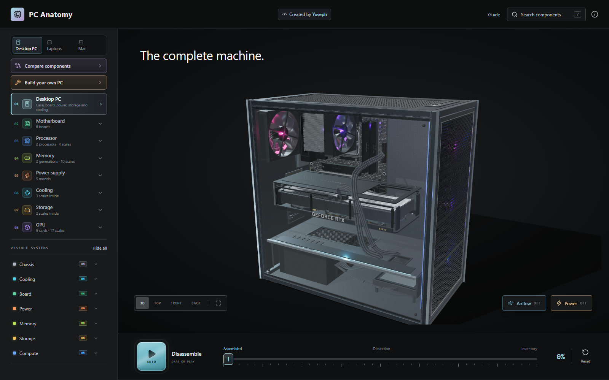
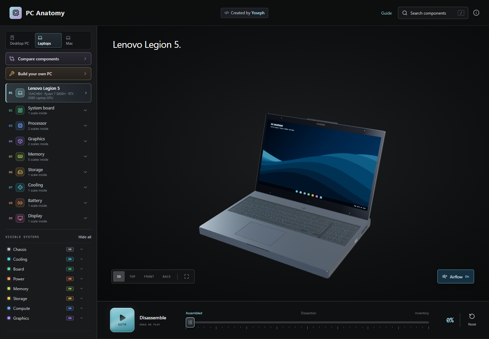
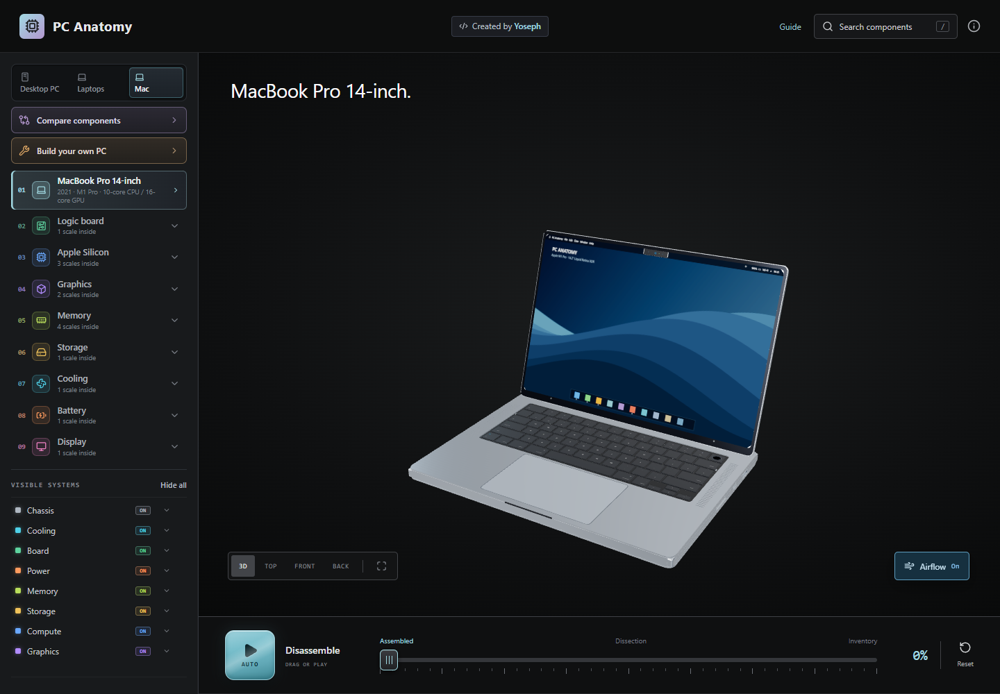
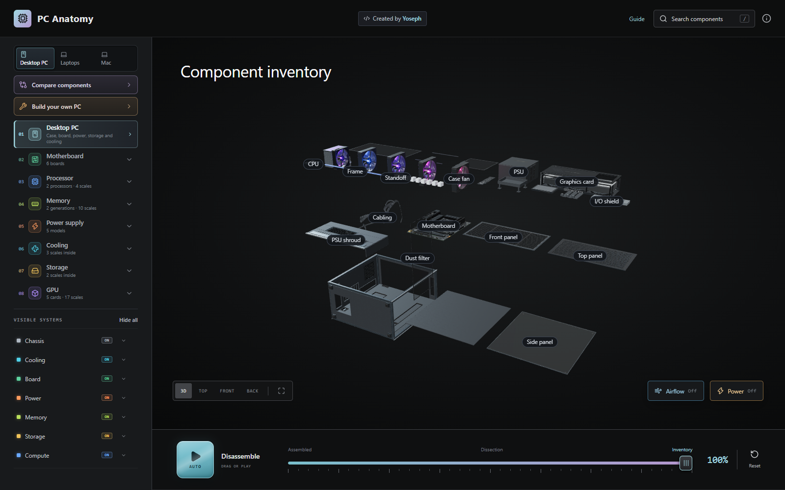
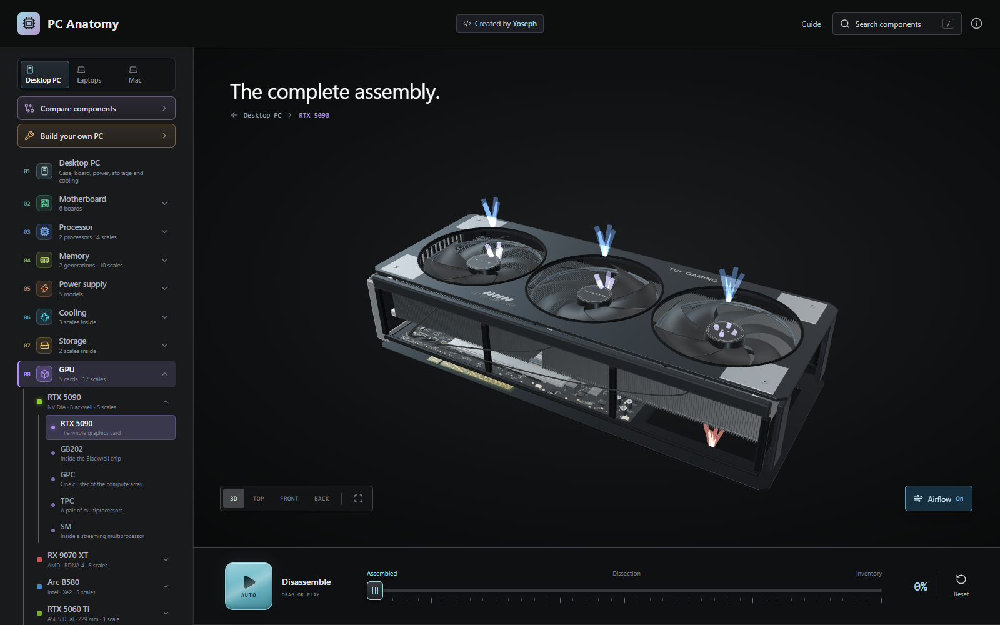
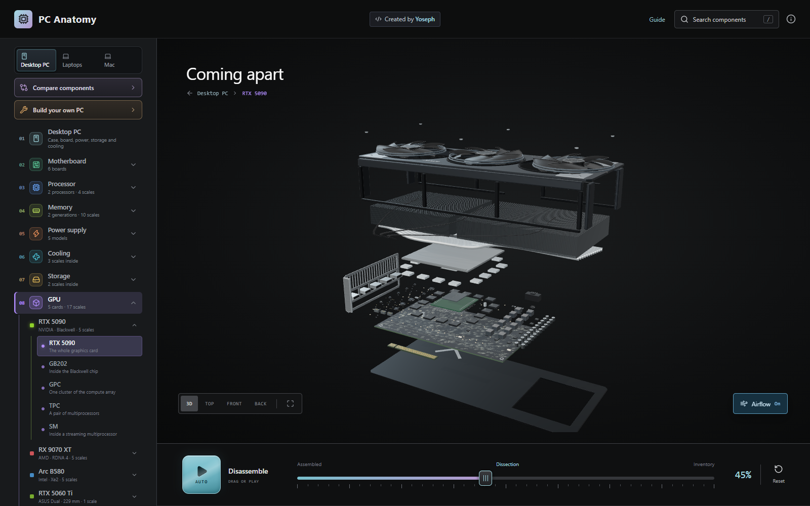
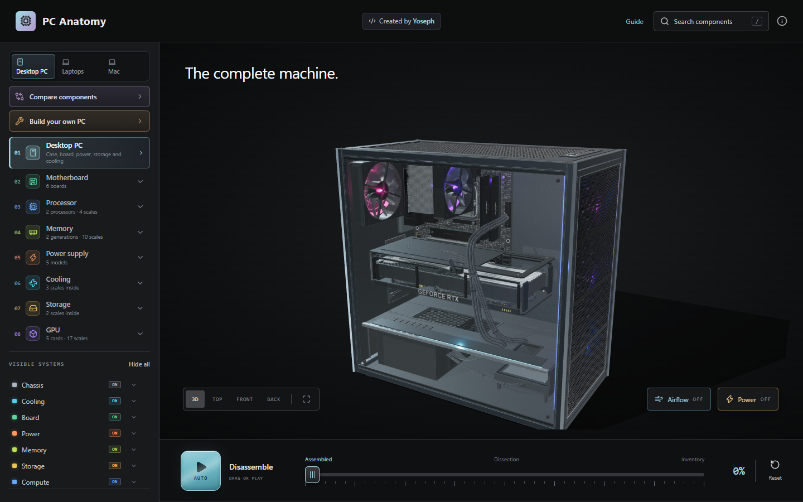
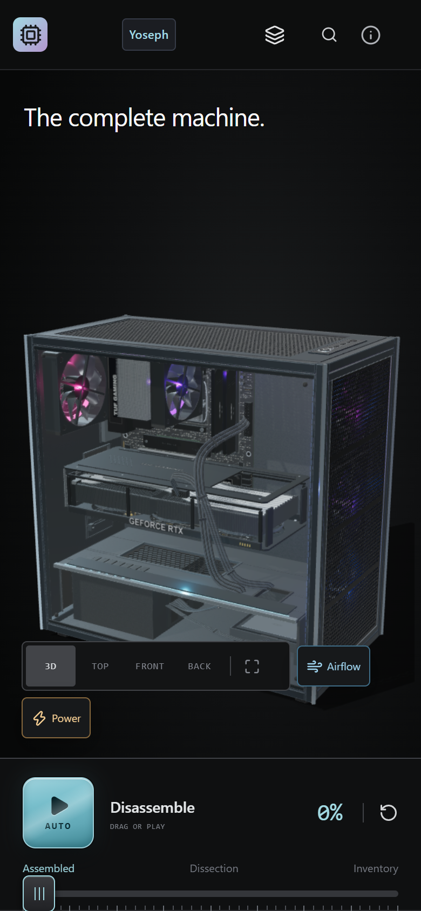
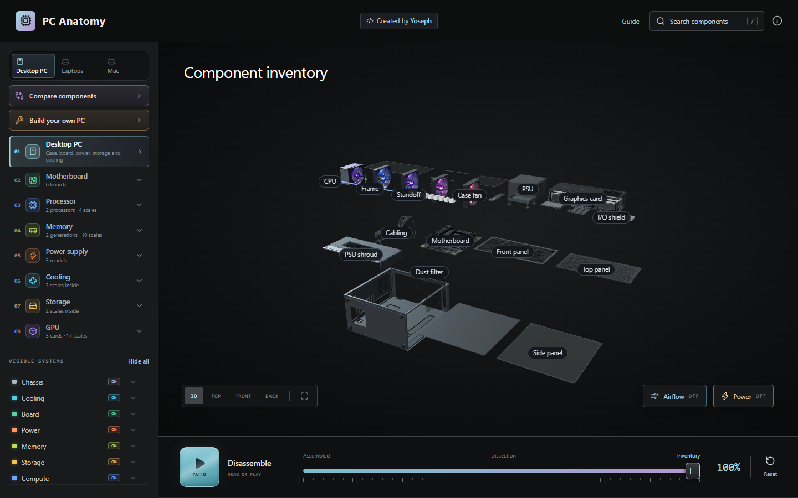
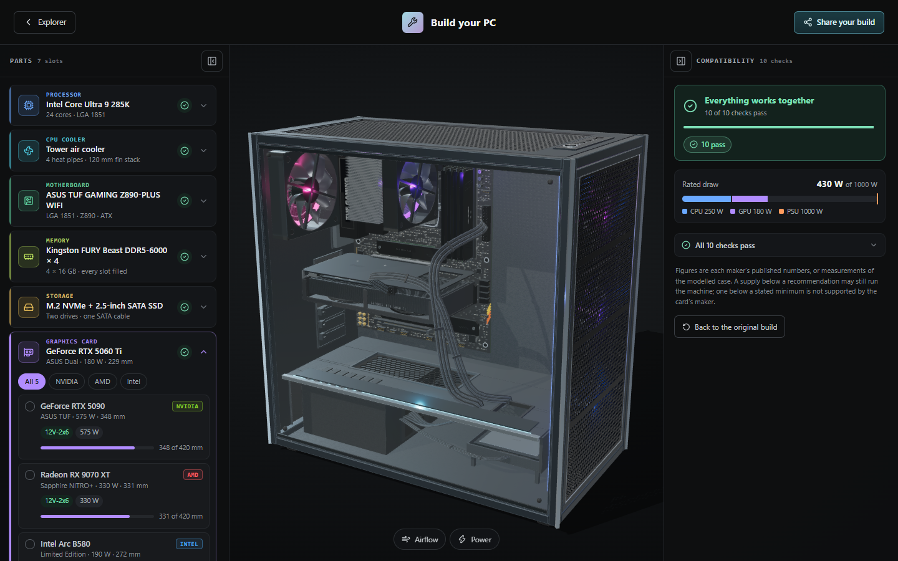

# PC Anatomy
[](https://ownit.ownit-worker.workers.dev/Yoosseph/pc-anatomy)
[](https://github.com/Yoosseph/pc-anatomy/actions/workflows/ci.yml)
[](LICENSE)
[](https://pc-anatomy.com/)
[](#quick-start)
[](https://www.typescriptlang.org/)
[](https://threejs.org/)

PC Anatomy is an open-source 3D explorer that takes a desktop computer apart from the assembled ATX tower down to a single GPU streaming multiprocessor, and a DDR5 memory module down to the transistor and capacitor that hold one bit.

## [**Explore the live demo →**](https://pc-anatomy.com/)

Ideas worth building are collected on the [**roadmap and Kanban board →**](https://github.com/users/Yoosseph/projects/1). If you would like to contribute but have nothing particular in mind, start there: the Backlog column holds the suggestions and feedback waiting to be picked up.

Before changing any code, read [**ARCHITECTURE.md →**](ARCHITECTURE.md). It is the full technical picture of the project: the scale tree, where every module lives, the conventions behind the geometry, and the traps that are not obvious from reading the source. It is written to be read start to finish by whoever is doing the work, person or language model.

Every polygon is generated in TypeScript with three.js. There are no imported models, image textures, or other runtime asset files. The more than 590 selectable components each carry a name, a description, an explanation of their purpose, specifications, and citations instead of stopping at a label.



Press **Auto** at the left end of the bottom bar to watch the machine take itself apart, or drag the timeline to move through the sequence by hand.

## Laptops and Mac

Choose **Desktop PC**, **Laptops**, or **Mac** in the system navigation. Laptops
opens a Lenovo Legion 5 15ACH6H; Mac opens a 2021 14-inch MacBook Pro with M1 Pro.
Both use the same component inspection, disassembly, inventory, search and
comparison workbench as the desktop. Open their boards to explore mobile
processors, graphics and memory, or inspect the battery, cooling and display.
The Legion memory path opens a physical FBGA package, its die, a bank, and a
transistor-and-capacitor cell array.

The Legion uses replaceable SO-DIMMs and M.2 storage with a separate laptop GPU.
The MacBook uses an integrated GPU and unified memory, with onboard flash.
The first Mac configuration is M1 Pro with 10 CPU and 16 GPU cores; other Apple
Silicon generations are future additions. Internal layouts and logical diagrams
are illustrative, with their scope and references in each component card.




## Desktop scale tree

```text
Desktop PC
├── Motherboard
│   ├── ASUS TUF GAMING X670E-PLUS WIFI
│   ├── ASUS TUF GAMING Z890-PLUS WIFI
│   ├── ASUS TUF GAMING B650M-PLUS WIFI
│   ├── MSI MAG X870 TOMAHAWK WIFI
│   ├── GIGABYTE Z890 AORUS ELITE WIFI7
│   └── ASRock B850M Pro RS WiFi
├── Processor (in the board's socket: the CPU on the board opens it too)
│   ├── Ryzen 9 9950X
│   │   └── Ryzen I/O die
│   └── Core Ultra 9 285K
│       └── Core Ultra I/O tile
├── Memory
│   ├── Kingston FURY Beast DDR5-6000
│   │   └── DRAM package
│   │       └── DRAM die
│   │           └── Bank
│   │               └── Cells
│   └── Kingston FURY Beast DDR4-3200
│       └── DRAM package
│           └── DRAM die
│               └── Bank
│                   └── Cells
├── Power supply
│   ├── ASUS TUF Gaming 650W Bronze · non-modular
│   ├── ASUS TUF Gaming 750W Bronze · non-modular
│   ├── ASUS TUF Gaming 850W Gold · modular
│   ├── ASUS TUF Gaming 1000W Gold · modular
│   └── ASUS TUF Gaming 1200W Gold · modular
├── Cooling
│   ├── Case fan
│   ├── CPU cooler
│   └── Liquid cooling
├── SATA SSD
└── GPU
    ├── RTX 5090
    │   └── GB202 processor
    │       └── Graphics processing cluster (GPC)
    │           └── Texture processing cluster (TPC)
    │               └── Streaming multiprocessor (SM)
    ├── Radeon RX 9070 XT
    │   └── Navi 48 processor
    │       └── Shader engine
    │           └── Workgroup processor (WGP)
    │               └── Compute unit (CU)
    └── Arc B580
        └── BMG-G21 processor
            └── Render slice
                └── Xe-core
                    └── Xe vector engine (XVE)
```

The slider moves each scale from its assembled state to a laid-out inventory. Search can jump directly to a component at any depth, while breadcrumbs and the scale navigator move back through the machine.



Descending into a part rebuilds it at its own scale with its own timeline, so the graphics card that was installed in the tower comes apart into its shroud, fans, fin banks, heat pipes, vapor chamber, board and backplate.





## The interface

The rail on the left carries the scale tree and per-system visibility. The GPU menu holds five cards, the RTX 5090, Radeon RX 9070 XT, Arc B580, RTX 5060 Ti and RTX 5060, each with its own dropdown of scales. The Memory menu holds the installed DDR5 module and a DDR4 module from the same line, so the two generations can be taken apart side by side or compared in the comparison workbench. The Power supply menu lists five TUF Gaming units, from a 650W Bronze with fixed cables to a 1200W Gold with modular sockets; the tower carries the 1000W Gold, the supply ASUS recommends for its RTX 5090. The bar along the bottom is the disassembly timeline, with the **Auto** key at its left-hand end, the named phases above the slider, and a reset on the right. Left-click an explorable component to open it; right-click to inspect it and use the detail, hide, isolate and focus controls. On a touch screen, a tap shows the component's card and its **Take apart** button opens it. At 100% every laid-out part carries its name, and tapping a name describes it. Hidden components remain available from the stage tracker until they are restored, the scale changes, or the explorer is reset. The **Airflow** switch beside the camera views draws the path the air takes, cool where it enters and warm where it leaves, and it fades as soon as the disassembly slider moves. It starts on wherever there are fans except on the complete machine, where the case is closed and the switch is there to turn it on. The corner expand control toggles browser fullscreen. The address bar follows you: a link such as `https://pc-anatomy.com/?scale=sm` opens straight on the RTX 5090's streaming multiprocessor, `&part=` describes a part, `&open=` sets the disassembly, and the back button climbs back out.

| Workbench                                                                                                              | On a phone                                                                                                                                               |
| ---------------------------------------------------------------------------------------------------------------------- | -------------------------------------------------------------------------------------------------------------------------------------------------------- |
|  |  |



On the assembled desktop, turn on **Power** beside **Airflow** to trace the
24-pin ATX, 8-pin EPS, 12V-2x6 GPU and SATA power feeds. Choose **All**, **CPU**,
**GPU** or **Storage** to follow a destination; GPU includes its separate PCIe
slot feed. The legend explains the voltages and opens component details. The
paths remain visible through the case, fade during disassembly, and use static
arrows when reduced motion is enabled. Colors identify routes; the animation
shows direction rather than measured speed or watts.

## Build your own PC

Press **Build your own PC** under Compare to open the build workspace: the
parts list on one side, the tower in the middle, and on the other side whether
the parts work together. Choose the processor, CPU cooler, motherboard,
memory, storage, graphics card and power supply, and the tower changes to
match:

- the Ryzen 9 9950X or Core Ultra 9 285K in the socket, or the socket's cover
  when the processor does not fit the board;
- one of six boards from four makers: ASUS's TUF X670E, Z890 or micro-ATX
  B650M, MSI's X870 Tomahawk, GIGABYTE's Z890 AORUS Elite or ASRock's
  micro-ATX B850M Pro RS, each in its maker's finish with its own slots;
- two memory modules, four, or none when they do not fit;
- the RTX 5090, Radeon RX 9070 XT, Arc B580, RTX 5060 Ti (ASUS Dual, 229 mm)
  or RTX 5060 (MSI INSPIRE ITX, 145 mm) seated in the slot at its own length,
  with its power cable on its own socket;
- the tower air cooler, or a 360 mm liquid cooler with its pump on the socket
  and its radiator behind the front fans;
- the M.2 drive alone, or with a 2.5-inch SATA SSD and its cable in the cage;
- a TUF Gaming supply under the shroud: the 650W or 750W Bronze with fixed
  cables, or the 850W, 1000W or 1200W Gold, fully modular.

Each slot is a row in its own colour with its part and its result; open one to
see every part it takes, filtered by maker if you like. Each option shows the
facts the checks compare, green where they agree with the rest of the build
and red where they do not, a meter for a card's length against the case and a
supply's rating against the draw, and why it would not work if it would not.
Either panel folds away to a rail to give the tower the room.

The colours are the whole site's, not just this page's: the explorer's scale
menus, the visible systems, the part card, search and the comparison picker
give each kind of part the same one, so graphics are violet, memory lime and
power orange wherever they appear, and each graphics card's menu is marked in
its chip maker's colour.

The compatibility panel sums the build up first: what fails, what is worth
checking and what passes, each count a link to its checks. Problems come
first, one line each; click one to see what is wrong, the sources behind it,
and a button to the part that would fix it. The build starts on the machine
the explorer shows, which passes every check: its 1000W Gold is the supply
ASUS recommends for the RTX 5090.

Every figure the checks use is cited: whether the processor fits the board's
socket, whether the cooler and the board fit the case, whether the memory fits
the DDR5 slots and how fast the processor's maker rates two modules or four,
whether the card fits in front of the fans or the radiator, whether the supply
meets the card maker's minimum or recommendation and has the leads the card
and the drives take, and the processor's and card's rated power against the
supply. The case is the same in every build.

In the tower the processor is a part of its own, in the Compute system: it can
be pointed at, hidden and taken apart by itself, and it lifts out of the socket
as the machine comes apart. The build is written into the address, so **Share
your build** copies a link to it and shows you the link it copied. On a phone the tower sits on top and the parts and the checks are two
tabs underneath, which drop away to give the tower the screen. Every part on
offer is a scale of its own: it can be taken apart from the explorer and set
beside another in the comparison workbench.



## Quick start

PC Anatomy requires Node.js 22.13 or newer.

```bash
git clone https://github.com/Yoosseph/pc-anatomy.git
cd pc-anatomy
npm install
npm run dev
```

Vite prints the local development URL. To create and preview a production build:

```bash
npm run build
npm start
```

The project is entirely static. The production output is written to `dist/` and needs no backend.

## Search appearance

The public URL is `https://pc-anatomy.com/`. The HTML entry includes a canonical URL, descriptive title, social preview metadata, and WebSite / WebApplication structured data. `public/guide/index.html` is a readable hardware guide that works without JavaScript and links back to the explorer.

Every scale and part has its own address, and `public/sitemap.xml` lists them all; regenerate it with `node --experimental-strip-types scripts/generate-sitemap.mjs` after adding scales or parts. The canonical link follows the place being shown.

Deploy the entire `dist/` directory, including `guide/`, `robots.txt`, `sitemap.xml`, and the icon files. Serve `/guide/` from its own `index.html` before applying any single-page-app fallback. If the hostname changes, update the canonical and social URLs in both HTML pages, the structured data, and the sitemap and robots files together.

After deployment, submit `https://pc-anatomy.com/sitemap.xml` in Google Search Console and request indexing of the homepage and guide. Indexing, favicon display, and ranking are decided by Google and may take time after a recrawl. Do not add fabricated ratings or keyword stuffing.

The browser and search icons are derived from `public/favicon.svg`. Run `node scripts/generate-icons.mjs` to regenerate the PNG and multi-resolution ICO variants (uses Playwright and Microsoft Edge). `public/pc-assembled.png` is a capture of the actual model; `public/social-preview.png` is its sharing card.

## Working on the code

The technical detail lives in **[ARCHITECTURE.md](ARCHITECTURE.md)**, next to this file. It covers how to run and check the project, the full scale tree, where every module lives and what it answers for, the interface a geometry builder is handed, the conventions that keep the models consistent, how to add a component or a whole new scale, the sourcing rules, and what the tests do and do not verify.

Read it before the first edit. It is kept current with the code, and a change that moves a module or settles a decision should update it in the same commit.

## Accuracy and sources

The machine follows published ATX dimensions where those dimensions are standardized. Seventeen products are named and modeled as specific subjects: the GeForce RTX 5090, AMD Radeon RX 9070 XT, Intel Arc B580, ASUS Dual GeForce RTX 5060 Ti, MSI GeForce RTX 5060 INSPIRE ITX, AMD Ryzen 9 9950X, Intel Core Ultra 9 285K, ASUS TUF GAMING Z890-PLUS WIFI, ASUS TUF GAMING B650M-PLUS WIFI, MSI MAG X870 TOMAHAWK WIFI, GIGABYTE Z890 AORUS ELITE WIFI7, ASRock B850M Pro RS WiFi, and five ASUS TUF Gaming supplies: the 650W and 750W Bronze and the 850W, 1000W and 1200W Gold. The RTX 5090 is the card installed in the tower; the Radeon (after the Sapphire NITRO+), the Arc (Intel Limited Edition) and the two small cards are complete alternative cards opened from the GPU menu. The X670E board is the one installed; the other five open from the Motherboard menu, built on the same ATX or micro-ATX layout with their own socket, outline, slots and their maker's finish. The 1000W Gold, ASUS's recommended supply for the RTX 5090, is the one installed in the tower; the other four open from the Power supply menu. The rest is an illustrative desktop build that explains representative construction and relationships rather than reproducing a particular bill of materials.

Processor and GPU floorplans are explanatory diagrams of documented logical architecture. They are not semiconductor mask layouts and do not claim exact transistor-level placement. See [SOURCES.md](SOURCES.md) for standards, product documentation, architecture references, and the scope of each source.

The PSU exteriors follow published dimensions and visible product features; their internal boards explain the conversion chain and are not service diagrams of ASUS circuitry. Product and company names are used nominatively to identify the hardware being described. PC Anatomy is not affiliated with or endorsed by NVIDIA, AMD, Intel, ASUS, or any other named company.

## Contributing

Issues and focused pull requests are welcome. See [CONTRIBUTING.md](CONTRIBUTING.md) for the full guide. The [roadmap and Kanban board](https://github.com/users/Yoosseph/projects/1) lists what is open. Start with [ARCHITECTURE.md](ARCHITECTURE.md), keep written claims cited, preserve the distinction between physical models and logical diagrams, and run the full local checks before opening a change:

```bash
npm run check
npm run lint
npm test
npm run build
```

GitHub Actions runs these checks on every push and pull request using Node.js 22.

## AI disclaimer

AI-assisted tools were used selectively during development for coding support, debugging, iteration, and documentation. The project’s architecture, technical direction, design, integration, and validation were developed and maintained by the project maintainer.

PC Anatomy is available under the [MIT License](LICENSE).
